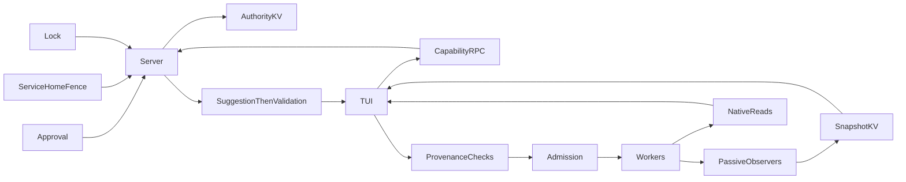

# Design

## Context

TypeScript; OpenCode ≥2.2.5; connected TUI; manually/project-locally loaded observers. No configuration activation.

## Decisions

**D1 — Authority.** `server/rpc`: user-selected ONE canonical home per local native-service deployment; observers agree. Process registration/fencing rejects conflicting configurations; multiple homes/cross-service worker ownership unsupported. Kernel exclusion protects same-home processes. Location-qualified bindings; execution-context identity; passive competitors. Genuine operation-bound coordinator/verifier/generation ask preserves deny; TUI-private capability/server-only verifier. Current generation/operation possession proofs, not RPC consent. Replacement preserves incumbent until genuine candidate approval AND durable publication; failures visibly hold. Reuse native RPC, not distributed KV-CAS, worker filesystem locks or transport.

**D2 — Ownership.** `ownership/state`: serialized same-plugin-ID KV, no CAS. Permanent safely-opened canonical lockfile, ignored `.opencode/conman/`; never unlink/replace; reject unsafe parents/paths/symlinks. Trusted Linux `/usr/bin/flock` (util-linux 2.42.4), short `-n -x 0` helper inherits parent FileHandle via stdin FD0; parent-retained FD. OFD exclusion until duplicates close; Bun 1.4.4 inheritance/retention/exclusion verification gates reliance. Unsupported helper/runtime/filesystem, contention/corruption hold; no installation fallback. Acquire before owner-record access; existence isn't occupancy. Crashed/unreleased records: termination proof, native-approved exact-owner reread/recovery under exclusion, separate rearm; no expiry. Disposal fences/drains before own-record release under lock/FD close; kernel releases only after old actions cannot run. Failed drain/write never advertises release. Reject pathname recovery/singleton/lease/election/daemon alternatives.

**D3 — Observation.** Worker-location `experimental.idle` bounded read-only snapshots use separate KV, never authority root. Incarnation/sequence/location/session/message-boundary/fingerprint, not execution nonces. Reload/disposal invalidates; global execution/tool/inbox events plus `session.get` ancestry invalidate ancestors; descendant success never empties ancestor arrays. TUI correlates current messages/log terminal boundary/activity/inbox/asks/versions. Missing/nonempty/stale/uncorrelated/gapped/ambiguous/abnormal/control-only observations hold; correlated empty snapshots permit settlement without tool restrictions. Resume uses only current genuine TUI-signed operation-bound reconciliation/native observation/asks/abnormal-state. Conversation cannot manufacture `issues[]`; unknown eligibility holds and requests TUI reconciliation. Reconnect inventories/rearms; counters survive.

**D4 — Reasoning.** Isolated task evidence/versioned sharing; stateless suggestion then exactly one task-only validation: accept/reject/unknown, actual nextStep scope/non-consent or criterion relationships to current completed native calls/inputs/results/inspected content. Both RPCs check current-observer possession/native-approved task and shared bounded generation capacity before model calls; repeated work/caches bounded. TUI independently checks provenance/IDs/revision/epoch/generation/turn/fingerprint/shared-versions. Input-bound receipt; completion persists ONLY criterion rationales/native call-message IDs/fingerprints/decision identity; raw inputs/results remain transient native history/cache, not KV. Server record: NO MODEL; claims aren't provenance. No recursive/follow-up-generating validator/permission authority. Defaults: 8 workers, 3 follow-ups/task, 20-minute expiry, 2 nonprogress.

**D5 — Publication/admission.** Aggregate finite-resource budget rejects additional creation/publication, never prunes unresolved intents/completion evidence; no retention service/new policy. Inspector shows last successfully persisted root; write failures visibly hold, never appear committed. Persist original-ID intents before native admission; non-atomic checks, asks invalidate, fixed non-consent framing. Pending approval cancellable on disposal/request abort without reply/cancel/approval-policy changes; future effects fenced. Delivery reconciliation bounded by exact caller ID across native inbox/messages AND journal; no text similarity/retries/rollback. Holds favour safety over availability; no atomic-barrier/model-obedience guarantee.



## D6 — Native coordination surface

Searchable `context.ui.dialog.select`, not fullscreen/custom panes: project → location-qualified agent → create/adopt; grouped workers → actions. Native `tui/ui` tokens; no bespoke colours/global IDs.

80×24 inset dialog:

```text
+----------------------------------------------------------+
| Coordinate / search                       [header fixed] |
| Group: migration                          [list flexes]  |
| > api / engineer / held                                  |
|   Goal: update endpoint; shared snapshot v3 [detail wraps]|
|   web / engineer / needs-input                           |
| Create / Adopt / Open / Share / Hold / Resume / Takeover  |
| Native navigation / select / back         [footer fixed] |
+----------------------------------------------------------+
```

Narrow wrapping/scrolling retains project/status; secondary metadata yields. Native keyboard/focus/cancellation; textual loading/empty/error/disabled-with-reason/held/needs-input/complete. Nonempty `NO_COLOR`; noncolour markers; contrast ≥4.5:1 text/≥3:1 large text.

Interaction: `specs/coordination-tui/spec.md` (native Open; confirmed sharing/control).
