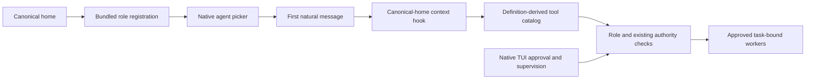

# Technical design

## Scope and recommendation

Ship a conversational coordinator for approved local tasks, goals and workers. User-approved scope: native agent-picker entry, restricted tools, native approval/status/optional supervision. Global configuration, publication and live arming are excluded.

Recommend one bundled primary role at the canonical home. External configuration violates packaging; arbitrary-agent coordination defeats role enforcement. Bundling unifies lifecycle and permissions without another service.

## Registration and identity

Use the disposable native agent transform after the passive-runtime return: synchronous, replayable, primary/visible, without model or default-agent overrides. Preserve user-defined identifier collisions untouched and report the bundled role unavailable; custom definitions never acquire coordinator authority.

One shared bundled-role predicate matches identifier, resolved `system` text and exact ordered five-rule action/resource/effect permission prefix, allowing only deny-effect suffix rules. Native hosts append denials; no host action names are hardcoded. Reordered/modified prefixes or expanded allow/ask rules fail eligibility, including copied prompts. Reuse definition data without metadata. Backend guards reject arbitrary, agentless or colliding roles; worker catalogs and create/adopt guards exclude only the actual bundled role.

Replace the entire seeded permission set: deny-all, allow `conman_inspect`, `conman_control`, `question`, then ask for `conman.*`, including attach/recover. No other capability is inherited.

## Outgoing tool catalog

Permission denial alone does not restrict the model-facing catalog. Prefer a canonical-home context hook owning only `event.tools`, retaining tools derived from bundled allow rules without another allowlist. Apply the shared identity predicate before trimming; other agents remain untouched. Reject registry-wide removal because it affects unrelated agents. Trimming grants no permission: deny-all and operation-specific native asks remain authoritative.

## Native entry and authority

The user selects the role through OpenCode's native picker and sends a natural message. Description: “Coordinate tasks and workers; never implements, hands resume to the TUI”. Purpose comes first because a convention lead-in clips it. Registration/selection initiate no mutations; attach/rearm remain support operations.

Remove coordinator onboarding wizards from `tui.ts`/`ui.ts`; retain approval, status, worker controls and optional automatic supervision. A wizard duplicates native entry and introduces a non-atomic agent-switch path. No plugin session creation/switching, dummy bootstrap prompt or automatic attachment belongs here.

Reuse existing private capabilities, canonical scope, operation-bound native asks, generation checks, provenance and connected-TUI follow-ups. Role identity is an additional eligibility check, never authority by itself. Unknown project/agent fields need clarification; worker evidence remains untrusted, sharing stays explicitly selected, and uncertain operations stay held without blind retry. Native reconciliation remains authoritative for resume/rearm.

## Resilience and boundaries

Collision or definition drift fails closed. Connection events fence supervision and mark disconnected, deferring inventory lookup to explicit user actions: native `server.connected` can precede location hydration. This avoids spurious entry-error toasts without rearming or weakening read validation. Denied/stale approvals and ambiguous results preserve held state; recovery uses native approval/reconciliation. Ownership and generations bound failures; scaling remains local.

Reject new services, catalogs, dependencies, schemas and prompt-based consent substitutes: no stated need justifies them.

| Component                   | Work kind                   | Done-criterion                                                              |
| --------------------------- | --------------------------- | --------------------------------------------------------------------------- |
| Bundled definition          | Agent-instruction authoring | Restricted conversational role                                              |
| Server integration          | Application code            | Scoped registration, role guards and definition-derived context catalog     |
| TUI/UI                      | Application code            | Native-only entry; support controls retained                                |
| Existing tests              | Verification code           | Actual native selection, tools, collisions and authority boundaries covered |
| README/spec synchronization | Documentation               | Dedicated-role entry and retained support accurately described              |
