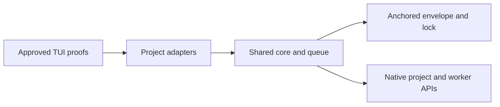

# Shared coordinator storage

## Choice and identities

Use one process-wide, refcounted core retained through `Symbol.for`, with project-local native adapters. Independent backends conflict on queues/ownership; forwarding couples availability to unload. No IPC or dependencies.

Separate canonical store identity, coordinator session/location, worker location and observer generation. Remove `home` and the nonhome registration branch. Preserve bundled-role catalog validation, collision handling, context filtering and worker exclusion through `isCoordinatorAgent`.

Resolve absolute `dataDir`, otherwise absolute nonempty `XDG_DATA_HOME/opencode-conman`, otherwise `homedir()/.local/share/opencode-conman`. Reject relative, empty explicit or unsafe inputs; never repair permissions. Invalid explicit dataDir still registers the dedicated role and held bootstrap; omit metadata dataDir without valid store identity, never substitute/open a fallback. Pin the first canonical store until its last reference closes; conflicts stay held. Canonical aliases agree.

## Physical publication and lifecycle

`storage.ts` owns one bounded envelope: coordinator state, observation registries, snapshots and invalidations. Never share through location-scoped `ctx.storage`. One queue serializes publication, observation updates, proof consumption and ownership transitions; asynchronous reasoning rechecks captured identities on reentry.

Reuse ownership's anchored descriptor, inode, owner, mode, no-symlink, single-hardlink and local-filesystem checks for datastore/observation access, not just `ownership.lock`. Use 0700/0600 directories/files. Revalidate anchors around bounded reads/publication; use exclusive anchored temporary files, file sync, atomic rename and directory sync. A durable initialization marker distinguishes first use from missing state. Corruption, unreadability or interrupted initialization holds without resetting limits/deliveries. Reload populated state; leave legacy paths untouched.

Separate prompt event admission from durable processing: synchronously record arrival/provenance into existing observer serialization without awaiting fsync. Bound count and bytes using the existing bounded JSON encoder: 64KiB/event, 1MiB retained total. Preserve ordering, `pendingIsProjected`, exact terminal/context correlation and generation rechecks; completed context alone never proves late work. Overflow closes admission; every stream termination, including ordinary EOF, invalidates the observer. Overflow, termination or processing error synchronously fences eligibility/admission, then durably invalidates.

Each project leases an adapter and registrations. Unload synchronously closes observer admission/eligibility, aborts asks/evaluations and observer startup, then awaits startup/drains. Dispose late-acquired hooks before lease release. Attempt every acquired cleanup despite failures; durably invalidate observations, remove registrations, release the lease only after successful cleanup. Initiator loss revokes attachment, not other projects' core. Final release revokes proofs, drains publication, releases ownership/descriptors before registry removal; acquisition waits. Competing processes stay held under kernel lock and explicit stale-owner recovery.

## Authority and routing

Bootstrap returns store identity and held/availability metadata only. Attachment resolves native session/project catalog without inventory; native approval binds store, initiating session/location, role, verifier and target. Publication requires post-ask revalidation; signed inspect fetches inventory, reconciles and separately rearms.

Full-state/evidence replies require verified native-tool coordinator context or approved-TUI possession; caller fields confer nothing. Proofs bind store, initiating session/location, operation/target, generation and next sequence; identity changes invalidate approval. Revalidate read eligibility immediately before every snapshot return. Durable commits remain accepted: failed eligibility returns committed/snapshot-withheld metadata, no snapshot/retry. Detach returns accepted metadata only. Snapshotless acknowledgements fence supervision pending fresh attachment/reconciliation. Recovery rechecks cancellation and actual dedicated role after approval and immediately before ownership-record write; without read authority, return metadata only.

RPC uses the enabled conversation project, never dataDir. Route catalogs, consent and default-model lookup to its verified project; worker APIs retain explicit locations. Resolve `model.default({location})`, verify location/non-null data, and use stateless generation. Unavailability holds without dispatch. Persist conversation selection; no worker/title-model fallback or model authority.

## Components and acceptance boundaries

Application code: storage owns bounded publication; server/ownership own intake, fencing and cleanup; rpc/state own identities; tui owns authority-safe inventory sequencing. Done: boundaries hold. No new files/evaluator/UI changes.
