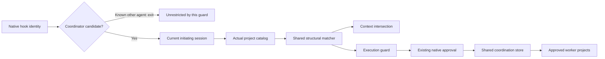

# Effective coordinator policy

## Context and decision

OpenCode 2.2.5 applies configuration after external agent transforms, appending global and per-agent permissions and potentially changing fields. The deny-only suffix predicate rejects matching roles under inherited allow/ask policy, bypassing context restriction. Registration-time observations cannot authenticate native origin: `Agent.Info` lacks provenance and plugin context cannot read configuration.

Choose semantic recognition plus runtime containment. The user accepts exact configured copies as the restricted role, not authenticated bundled authorship. Preserve shared-store coordination across projects.

## Options and rationale

1. **Deny-only suffix recognition:** simple, but rejects effective policy and loses the restriction boundary.
2. **Structural recognition with execution containment:** tolerates inherited policy while independently enforcing the tool surface. Recommended for resilience, maintainability and minimal scope.
3. **Provenance registry or configuration override:** adds lifecycle ambiguity without native origin proof, or changes user policy. Rejected; no registry, RPC, dependency or global setting justified.

## Recognition and execution

Use one structural matcher for authority, backend worker exclusion and TUI selection: exact identifier, system text, primary mode, visible state and ordered five-rule definition prefix. Permission suffixes do not establish identity. Changed or unrelated definitions remain untouched and cannot acquire coordinator authority; semantic copies remain excluded as workers. Keep prompts unchanged apart from predicate/type work.

Derive allowed tool names from the definition's allow rules, never a parallel list. Context filtering only removes entries: expose at most `conman_inspect`, `conman_control` and `question`. Never restore a configured-denied tool.

Add `ctx.tool.hook("execute.before", ...)` as authoritative guard alongside context filtering. Native `sessionID`/`agent` are trusted core `Tool.Context`, not model arguments. Known nonempty agents other than `conman-coordinator` exit before session lookup: in-flight execution may retain its agent after `session.switchAgent` changes persisted assignment. Missing agent fails closed. Coordinator candidates resolve `ctx.session.get({ sessionID })`, then `ctx.agent.list({ location: { directory: session.location.directory } })`. Validate current session, catalog location, active project participation and assigned agent against the initiating project. Recheck identity after awaits using existing identity/fingerprint checks; reject relocation, archival, agent changes or hook/session disagreement. Apply the shared matcher; nonmatching definitions receive no restrictions or authority.

For matching roles, reject tools outside the derived set before execution. The verified native hook covers ordinary calls, Code Mode dispatch and `Tool.check`; context-deleted tools are absent from model-step snapshot execution. Preserve `forceNativeAsk` and operation-bound `conman.*` approval; configured denial remains final.

## Failure handling and lifecycle

Missing identity fails closed; coordinator-candidate catalog errors or unstable lookup reject execution. Candidate context failure clears its tool map and logs metadata only; execution protection remains independent. No positive eligibility cache. Candidate-only lookups isolate failures and avoid stale authority.

Register guards through project cleanup/disposal and abort fencing; unload invalidates in-flight checks before registrations retire. Preserve other participants' shared authority. Worker targets retain explicitly approved locations, never the initiating project's location. No storage migration or automatic retry/rearm.

## Component boundaries

| Part                  | Work kind        | Done criterion                                               |
| --------------------- | ---------------- | ------------------------------------------------------------ |
| Matcher/types         | Application code | Shared semantic predicate handles merged suffixes            |
| Server guards         | Application code | Context and execution fail closed without overriding consent |
| TUI integration       | Application code | Same eligibility predicate; no layout/assets needed          |
| Existing suites       | Test code        | Worker-coordination, TUI and host regressions covered        |
| README/spec alignment | Documentation    | Effective-policy and semantic-copy limitation explicit       |
