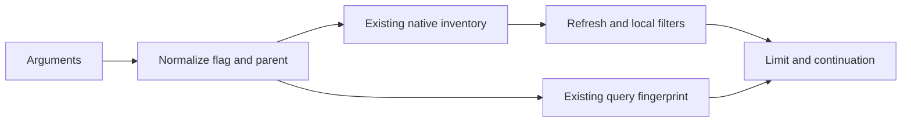

# Design

## Context

See [proposal.md](proposal.md) for motivation. The existing sessions function passes `parentID` to `readNativeInventory`, applies local filters before the result limit, and owns bounded scanning, refresh and continuation. Native metadata already exposes parent identity.

## Goals / Non-Goals

Keep hierarchy selection inside the existing query pipeline. No adapter changes, new components, recursive traversal, ownership changes or pagination redesign are needed.

## Decisions

Normalize omitted `includeSubagents` to `false`. Derive the effective parent selector using explicit argument presence: retain supplied `parentID` null/string; otherwise use null for roots when the flag is false, or leave parent selection unrestricted when true. This preserves direct-child selection and avoids confusing explicit null with omission.

Pass the effective selector through existing native parent filtering and enforce it again locally before limiting results, using the existing refresh path. Native-only filtering lacks the local consistency check; local-only filtering scans unnecessary children. Reusing both boundaries is the smallest resilient option.

Include the normalized boolean consistently in the existing query fingerprint alongside normalized parent selection and other filters. Omission and false share identity. Changing the flag rejects continuation even with an explicit parent selector; this conservative choice preserves changed-filter rejection without introducing semantic-equivalence machinery. Existing buffering, bounds, handle ownership, expiry and refresh remain intact.

## Risks / Trade-offs

- Parent changes during refresh: local filtering retains the existing best-effort inventory model, not snapshot guarantees.
- Selective queries yield empty pages: existing bounded continuation remains the recovery path; scan limits stay unchanged.
- Breaking discovery default: callers needing all levels explicitly opt in; no storage migration is involved.

## Migration Plan

Deployment uses the existing plugin lifecycle. Rollback restores the prior implementation; persisted coordination state is unaffected.
