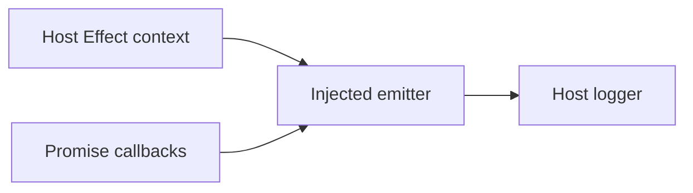

# Design

## Context

Promise callbacks lack a host logger; host logging needs Effect context without moving coordination into Effect.

## Decisions

- **Host bridge:** In `server.ts`, capture `Effect.context` inside the host Effect entrypoint and bind `Effect.runSyncWith` to that context. An instance-local emitter runs host log effects through this runner, including detached Promise callbacks. Adapt the Promise definition with `promise/adapter.fromPromise`, closing over the emitter. The adapter alone does not capture context for later runs. Adapter scope ownership preserves setup, callbacks, cleanup ordering, and failure propagation; a full Effect rewrite adds lifecycle risk.
- **Injection:** Migrate every existing log call. Inject the emitter into observer, connection, and tool ports; thread optional immutable diagnostic context through native inventory and refresh helpers. Diagnostic types live in `native-connection.ts` with type-only imports. No module-global logger, ambient async state, identity map, or additional module.
- **Privacy and correlation:** Generate independent random tokens per tool/RPC/background operation, shared across its reads/pages; continuation invocations get fresh tokens. Discriminated records and runtime projection admit only fixed events/operations/phases/classifications, finite nonnegative durations, aggregate counts, continuation-presence booleans, and validated diagnostic tokens. Exclude raw exceptions/messages/stacks, native/session IDs, cursors, paths, URLs, and payloads. Detailed user errors remain separate and unchanged.
- **Classification and filtering:** Connection phases distinguish registration, client construction, service/incarnation verification, revalidation, operation, and completion; inventory phases distinguish list/activity/permission/form reads. Existing signals identify timeout/disposal; explicit branch codes identify validation, boundary catches identify transport, otherwise unknown. No message parsing. Host minimum level controls debug operation detail, info lifecycle, warn degradation, and error failures; no plugin verbosity option.
- **Containment:** Guard token creation, projection, and host execution; suppress re-entry and swallow diagnostic failures without fallback. No awaited logging, retries, timers, or business-state changes. Declare Effect peer `^4.0.6`, development pin `4.0.6`, and matching lockfile. Native host fixtures compose `product.effect(ctx)` with their Promise probe through `fromPromise`.

## Risks / Trade-offs

Dropped diagnostics preserve outcomes. README explains that diagnostic correlation cannot identify individual host sessions. No custom logger, file sink, stderr fallback, or deployment change.
